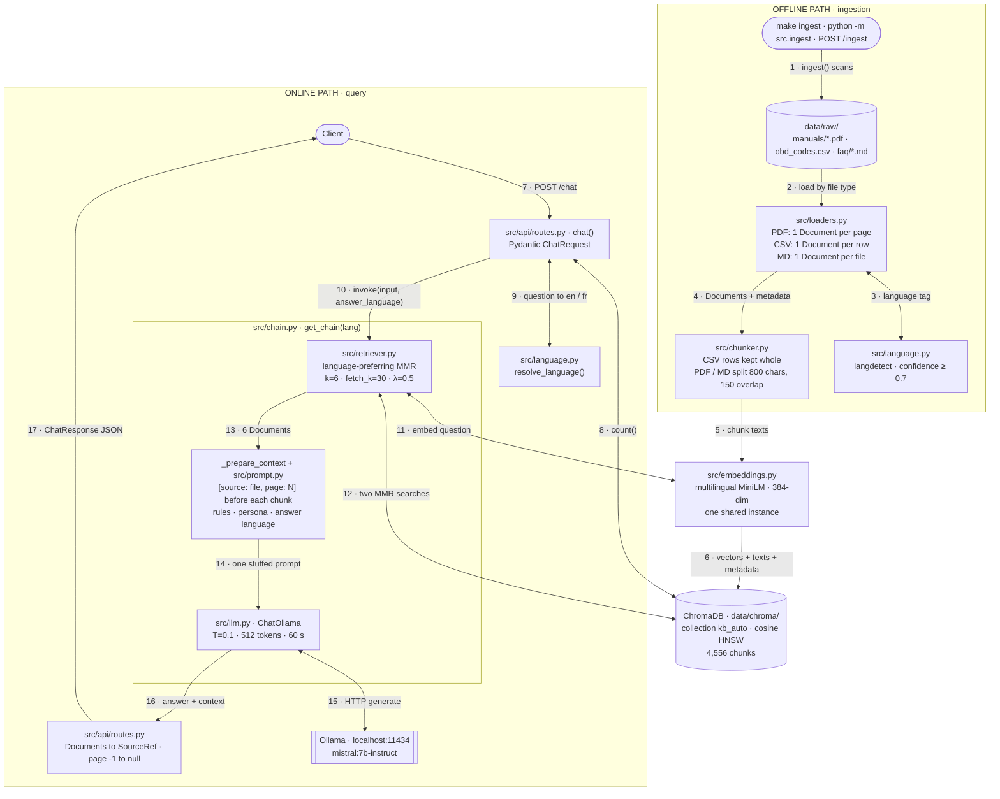

# RAG POC — Project Guide

A complete walkthrough of the offline multilingual RAG chatbot: what it does, how every part works, how data moves through it, and what the evaluation runs showed.

> **Snapshot:** 19 October 2026. Describes the code in the working tree, including the uncommitted language-aware changes (`src/language.py`, the changes to `src/retriever.py`, `src/chain.py`, `src/prompt.py`, `src/api/*`, `eval/run_eval.py`). Corpus numbers come from the live ChromaDB collection; evaluation numbers come from the JSON files in `eval/results/`.

---

## Contents

1. [What the project is](#1-what-the-project-is)
2. [The stack](#2-the-stack)
3. [Architecture diagram](#3-architecture-diagram)
4. [Every numbered arrow, explained](#4-every-numbered-arrow-explained)
5. [Module reference](#5-module-reference)
6. [The corpus](#6-the-corpus)
7. [Configuration](#7-configuration)
8. [API reference](#8-api-reference)
9. [Evaluation](#9-evaluation)
10. [Tests and smoke scripts](#10-tests-and-smoke-scripts)
11. [How to run everything](#11-how-to-run-everything)
12. [Project history](#12-project-history)
13. [Migrating to ElBATIMA](#13-migrating-to-elbatima)
14. [Known issues and next steps](#14-known-issues-and-next-steps)
15. [Glossary](#15-glossary)

---

## 1. What the project is

A chatbot that answers technical questions from a private set of documents and runs entirely on a laptop. It makes no cloud calls and sends no data off the machine.

It uses **RAG (retrieval-augmented generation)**. The language model does not answer from memory. For each question the system:

1. finds the passages in the document collection that best match the question,
2. pastes those passages into a prompt with strict rules,
3. asks a local LLM to answer **using only those passages**, citing each one.

If the passages do not contain the answer, the model must refuse with a fixed sentence instead of guessing.

| | |
|---|---|
| **Current domain** | Automotive: the 2017 Ford F-150 owner's manual in English and French, plus a list of 469 OBD-II diagnostic trouble codes |
| **Real target** | ElBATIMA, a BTP (building and public works) knowledge base. The automotive corpus is a rehearsal. |
| **Design rule** | The code is domain-agnostic. Moving to ElBATIMA should only change the documents, the eval questions, the persona string in the prompt, and `.env` values. |
| **Languages** | English and French (questions and answers) |
| **Answer contract** | Grounded in the documents, cited inline, in the user's language, refuses when unsure, never invents identifiers |

---

## 2. The stack

| Layer | Tool | Where in the code | Why this choice |
|---|---|---|---|
| Orchestration | LangChain 0.3 | all of `src/` | Standard `Document` type, retriever and prompt interfaces, and ready-made chains (`create_retrieval_chain`, `create_stuff_documents_chain`) |
| Loaders | `PyPDFLoader`, `CSVLoader`, `UnstructuredMarkdownLoader` | `src/loaders.py` | One loader per source type. PyPDF keeps page numbers, CSVLoader gives one Document per row. |
| Splitter | `RecursiveCharacterTextSplitter` | `src/chunker.py` | Cuts at paragraph, then line, then sentence boundaries before falling back to words |
| Embeddings | `paraphrase-multilingual-MiniLM-L12-v2` via `langchain_huggingface` | `src/embeddings.py` | Multilingual (50+ languages incl. FR/AR), 384 dimensions, runs on CPU, ~470 MB |
| Vector store | ChromaDB `PersistentClient` | `src/vectorstore.py`, data in `data/chroma/` | Embedded database, no server process, HNSW index with cosine distance |
| Retrieval | MMR (max marginal relevance) | `src/retriever.py` | Avoids returning several near-identical passages |
| Language detection | `langdetect` | `src/language.py` | Tags each chunk at ingest and detects the question language at query time |
| LLM | Ollama serving `mistral:7b-instruct` (4-bit, 4.4 GB) | `src/llm.py` via `langchain_ollama.ChatOllama` | Local and free. Chosen over Llama 3 8B for stronger French instruction-following. |
| API | FastAPI + uvicorn | `src/api/` | Request validation, automatic OpenAPI docs, startup hooks |
| Schemas | Pydantic v2 | `src/api/schemas.py` | Bad requests get HTTP 422 automatically |
| Config | pydantic-settings | `src/config.py` | Every knob in one class, overridable from `.env` or environment variables |
| Evaluation | custom harness (+ optional RAGAS) | `eval/run_eval.py` | Deterministic metrics that are cheap to run; RAGAS behind a flag |
| Tests | pytest, pytest-mock, FastAPI `TestClient` | `tests/` | 54 tests, the LLM is mocked |

---

## 3. Architecture diagram

The system has **two paths that share one ChromaDB collection and one embedding model**:

- **Offline path (arrows 1–6):** turns the documents into searchable chunks. Runs once, and again whenever the documents change.
- **Online path (arrows 7–17):** answers one question. Runs on every `POST /chat`.

Follow the numbers in order. Each one is explained in [section 4](#4-every-numbered-arrow-explained).

### 3.1 Full diagram (plain text, renders anywhere)

```text
  ═══════════ OFFLINE PATH · INGESTION  (run once, or after the documents change) ════════════

  make ingest  |  python -m src.ingest  |  POST /ingest {"wipe_first": true}
        │
      [1]   src/ingest.py ingest(): drop the old collection if asked, scan data/raw/
        ▼
  ┌─────────────────────────────────────────┐
  │ data/raw/                               │
  │   manuals/*.pdf   F-150 manual EN + FR  │
  │   obd_codes.csv   469 OBD-II codes      │
  │   faq/*.md        (no files yet)        │
  └─────────────────────────────────────────┘
        │
      [2]   each file goes to the loader for its type
        ▼
  ┌─────────────────────────────────────────┐                       ┌────────────────────────┐
  │ src/loaders.py                          │ [3] first 500 chars   │ src/language.py        │
  │   PyPDFLoader   1 Document per page     │ ────────────────────► │   langdetect, seeded   │
  │   CSVLoader     1 Document per row      │                       │   confidence >= 0.7    │
  │   Markdown      1 Document per file     │ ◄──────────────────── │   else default "en"    │
  └─────────────────────────────────────────┘    "en" or "fr"       └────────────────────────┘
        │
      [4]   Documents + metadata {source, page or -1, doc_type, language, chunk_id}
        ▼
  ┌─────────────────────────────────────────┐
  │ src/chunker.py                          │
  │   obd_code rows   kept whole, 1 chunk   │
  │   manual / faq    split: 800 chars max, │
  │                   150 chars overlap     │
  │   every chunk gets a new uuid4 chunk_id │
  └─────────────────────────────────────────┘
        │
      [5]   chunk texts
        ▼
  ┌─────────────────────────────────────────┐
  │ src/embeddings.py   (one per process)   │
  │   paraphrase-multilingual-MiniLM-L12-v2 │
  │   text -> 384 numbers, CPU, normalized  │
  └─────────────────────────────────────────┘
        │
      [6]   ids + vectors + texts + metadata, written in batches of 4,000
        ▼
  ╔═════════════════════════════════════════╗
  ║ ChromaDB          src/vectorstore.py    ║
  ║   PersistentClient -> data/chroma/      ║
  ║   collection "kb_auto", cosine HNSW     ║
  ║   4,556 chunks on disk                  ║
  ╚═════════════════════════════════════════╝


  ══════════════════════════ ONLINE PATH · QUERY  (every question) ═══════════════════════════

  Client  (curl, or a frontend listed in CORS_ORIGINS)
        │
      [7]   POST /chat {"question": "Comment vérifier l'huile ?", "language": "auto"}
        ▼
  ┌─────────────────────────────────────────┐                       ┌────────────────────────┐
  │ src/api/routes.py   chat()              │ [8] count()           │ ChromaDB               │
  │   Pydantic ChatRequest: 3-1000 chars    │ ────────────────────► │   (built in step [6])  │
  │   or HTTP 422                           │ ◄──────────────────── │                        │
  │   0 chunks -> canned refusal, stop      │    4,556              └────────────────────────┘
  │                                         │
  │                                         │ [9] question          ┌────────────────────────┐
  │                                         │ ────────────────────► │ src/language.py        │
  │                                         │ ◄──────────────────── │   resolve_language()   │
  └─────────────────────────────────────────┘    "fr"               └────────────────────────┘
        │
      [10]  invoke({"input": question, "answer_language": "French"})
        ▼
  ┄┄┄┄┄┄ inside src/chain.py · get_chain("fr") ┄┄┄┄┄┄┄┄┄┄┄┄┄┄┄┄┄┄┄┄┄┄┄┄┄┄┄┄┄┄┄┄┄┄┄┄┄┄┄┄┄┄┄┄┄┄┄
  ┌─────────────────────────────────────────┐                       ┌────────────────────────┐
  │ src/retriever.py                        │ [11] question         │ MiniLM embedder        │
  │   language-preferring MMR               │ ────────────────────► │   same model as [5]    │
  │                                         │ ◄──────────────────── │                        │
  │                                         │    384-dim vector     └────────────────────────┘
  │                                         │
  │                                         │ [12] 2 MMR searches   ┌────────────────────────┐
  │                                         │ ────────────────────► │ ChromaDB               │
  │                                         │   a) lang=fr, k=4     │   each search: top 30  │
  │                                         │   b) any lang, k=6    │   by cosine, then MMR  │
  │   merge: a first, then b, skip          │ ◄──────────────────── │   picks k with λ = 0.5 │
  │   duplicates, keep the first 6          │    chunks + metadata  └────────────────────────┘
  └─────────────────────────────────────────┘
        │
      [13]  6 Documents (the originals are kept aside for the response)
        ▼
  ┌─────────────────────────────────────────┐
  │ _prepare_context + src/prompt.py        │
  │   each chunk -> [source: X, page: N]    │
  │   page -1 shown as "N/A"                │
  │   + rules, persona, "Answer in French"  │
  └─────────────────────────────────────────┘
        │
      [14]  one prompt: rules + 6 chunks + question  ("stuff" chain)
        ▼
  ┌─────────────────────────────────────────┐                       ┌────────────────────────┐
  │ src/llm.py   ChatOllama                 │ [15] HTTP :11434      │ Ollama (local process) │
  │   temperature 0.1                       │ ────────────────────► │   mistral:7b-instruct  │
  │   max 512 tokens out, 60 s timeout      │ ◄──────────────────── │   4.4 GB, 4-bit, CPU   │
  └─────────────────────────────────────────┘    answer text        └────────────────────────┘
  ┄┄┄┄┄┄┄┄┄┄┄┄┄┄┄┄┄┄┄┄┄┄┄┄┄┄┄┄┄┄┄┄┄┄┄┄┄┄┄┄┄┄┄┄┄┄┄┄┄┄┄┄┄┄┄┄┄┄┄┄┄┄┄┄┄┄┄┄┄┄┄┄┄┄┄┄┄┄┄┄┄┄┄┄┄┄┄┄┄┄┄┄
        │
      [16]  {"input", "context": 6 original Documents, "answer"}
        ▼
  ┌─────────────────────────────────────────┐
  │ src/api/routes.py                       │
  │   Documents -> SourceRef                │
  │   page -1 -> null, snippet = 200 chars  │
  │   Ollama down -> HTTP 503               │
  │   any other error -> HTTP 500           │
  └─────────────────────────────────────────┘
        │
      [17]  ChatResponse {answer, sources[], latency_ms, retrieved_k}
        ▼
  Client
```

### 3.2 Same diagram as Mermaid

This version renders on GitHub, or in VS Code with a Mermaid preview extension. The numbers match the text diagram.



### 3.3 Shared building blocks

Both paths go through the same process-wide objects. Each is created once on first use and then reused. Creating a second embedding model or a second Chroma client in the same process is a bug.

| Getter | File | Holds | Used by |
|---|---|---|---|
| `get_client()` | `src/vectorstore.py` | ChromaDB `PersistentClient` at `data/chroma/` | ingest, retriever, API |
| `get_collection()` | `src/vectorstore.py` | the `kb_auto` collection (cosine) | ingest, `/chat` pre-check, `/health` |
| `get_embeddings()` | `src/embeddings.py` | the MiniLM model | ingest (step 5), retriever (step 11) |
| `get_llm()` | `src/llm.py` | `ChatOllama` client | chain |
| `get_retriever(lang)` | `src/retriever.py` | one retriever per language, plus the plain one | chain, eval |
| `get_chain(lang)` | `src/chain.py` | one chain per language, plus the plain one | `/chat`, eval, smoke test |

Tests reset these caches through `reset_caches()` in `src/retriever.py` and `src/chain.py` so each test can point them at a temporary database.

---

## 4. Every numbered arrow, explained

### Offline path: ingestion

**① Start ingestion** — `src/ingest.py · ingest(paths=None, wipe_first=False)`

There are three ways to start it:

| Command | What it does |
|---|---|
| `make ingest` | runs `scripts/ingest_all.sh`: deletes `data/chroma/`, then runs `python -m src.ingest` |
| `python -m src.ingest` | calls `ingest(wipe_first=True)` and prints the result |
| `POST /ingest {"wipe_first": true, "paths": null}` | the same function, inside the running API |

With `wipe_first=True` it deletes the collection and clears the cached handle so the next `get_collection()` creates a fresh one. With `paths=None` it calls `_load_all()`, which looks in `data/raw/` for every PDF (recursively), the file `data/raw/obd_codes.csv`, and the folder `data/raw/faq/`. With an explicit `paths` list it sends each file to a loader by its extension (`_load_paths()`).

At the end it returns `{"documents_loaded": N, "chunks_created": M, "duration_seconds": S}`.

**② Load each file** — `src/loaders.py`

| Function | Loader | Output | `doc_type` | `page` |
|---|---|---|---|---|
| `load_pdfs(dir)` | `PyPDFLoader` | one Document per PDF page | `manual` | page index from PyPDF |
| `load_csv(path)` | `CSVLoader` with `fieldnames=["code","description"]` | one Document per row, text like `code: P0420` / `description: Catalyst System Efficiency Below Threshold (Bank 1)` | `obd_code` | `-1` |
| `load_markdown(dir)` | `UnstructuredMarkdownLoader` | one Document per file | `faq` | `-1` |

Every Document leaves the loader with the same five metadata fields:

```python
{
  "source":   "manuals/2017-F-150-Owners-Manual-French.pdf",  # relative to data/raw/, forward slashes
  "page":     47,            # int; -1 means "this source has no pages" (CSV, Markdown)
  "doc_type": "manual",      # "manual" | "obd_code" | "faq"
  "language": "fr",          # "en" | "fr"
  "chunk_id": "uuid4",       # regenerated again by the chunker
}
```

**Why `page = -1` and not `None`:** ChromaDB refuses `None` as a metadata value. Storage uses `-1` as a stand-in, and the API turns it back into `null` in the response (step 16→17). That translation happens in one place only, `_doc_to_source_ref()` in `src/api/routes.py`.

A missing folder or file returns an empty list instead of raising.

**③ Tag the language** — `src/language.py · detect_language()`

For each Document the loader passes the first 500 characters to `langdetect`. The detector is seeded (`DetectorFactory.seed = 0`) so results are repeatable. The top guess is kept only if its probability is at least **0.7** (`INGEST_CONFIDENCE`) and it is a supported language (`en` or `fr`). Otherwise the tag defaults to `en`.

The same module is used again at query time (step 9), so ingestion and querying cannot disagree on what counts as French.

**④ Split into chunks** — `src/chunker.py · chunk_documents()`

Two rules, chosen by `doc_type`:

| Content | Rule | Reason |
|---|---|---|
| `obd_code` (CSV rows) | kept exactly as-is, one row = one chunk | A row like `P0420 → Catalyst System Efficiency Below Threshold (Bank 1)` only makes sense whole. Cutting it would separate the code from its meaning. |
| `manual`, `faq` | `RecursiveCharacterTextSplitter`, `chunk_size=800`, `chunk_overlap=150`, separators `["\n\n", "\n", ". ", " ", ""]` | 800 characters (about 150–200 tokens) holds a full procedure step. The splitter first tries to cut at blank lines, then line breaks, then sentence ends, then spaces. The 150-character overlap repeats the end of one chunk at the start of the next, so a sentence cut at a boundary survives in one of them. |

All metadata is copied from the parent Document to each of its chunks, and every chunk gets a **new** `chunk_id`. In the live collection, manual chunks average 684 characters and never exceed 800.

**⑤ Embed** — `src/embeddings.py · get_embeddings()`

Each chunk's text becomes a list of **384 numbers** (a vector). Texts with similar meaning get vectors that point in similar directions, **across languages**: a French sentence and its English translation land close together, which is why a French question can find English text.

Settings: `model_kwargs={"device": "cpu"}`, `encode_kwargs={"normalize_embeddings": True}`. Normalizing makes every vector length 1, which pairs with the cosine distance set on the collection in step 6. Change one and you must change the other. The model downloads from HuggingFace on first use and is cached under `~/.cache/huggingface/`.

**⑥ Store** — `src/vectorstore.py` + `collection.add()` in `src/ingest.py`

Each chunk is written with its id, vector, text and metadata. Writes go in batches of **4,000**, because Chroma rejects a single call above about 5,461 items. The collection is created with `metadata={"hnsw:space": "cosine"}`. HNSW is the index that makes nearest-neighbour search fast.

On disk this is `data/chroma/` (gitignored). The current collection holds **4,556 chunks**.

### Online path: answering a question

**Before the first request** — `src/api/main.py · lifespan()`

When uvicorn starts the app, it loads the embedding model, opens the collection, and asks Ollama for `/api/tags` with a 2-second timeout. Any failure only prints a warning, so the API still starts with Ollama down. `/health` will report it and `/chat` will return 503. CORS allows the origins in `CORS_ORIGINS` (default `http://localhost:3000`), with methods GET and POST.

**⑦ The request** — `POST /chat`

```json
{ "question": "Comment vérifier le niveau d'huile moteur ?", "language": "auto" }
```

Pydantic validates it as a `ChatRequest`: `question` must be 3–1,000 characters, `language` must be `"auto"`, `"en"` or `"fr"` (default `"auto"`). Anything else is rejected with HTTP 422 before any code runs.

**⑧ Empty-collection check** — `routes.chat()`

`get_collection().count()`. If Chroma itself fails, the API returns **500 "Retrieval error"**. If the count is 0 (nothing ingested yet), it returns the canned refusal immediately, with `sources: []`, `retrieved_k: 0`, and no LLM call.

**⑨ Decide the language** — `src/language.py · resolve_language(question, requested)`

- An explicit `"en"` or `"fr"` from the client always wins.
- `"auto"` runs langdetect on the question with a lower threshold, **0.5** (`QUERY_CONFIDENCE`), because questions are short and the detector is less sure on them.
- Too short or unclear (`"P0420"`, `"merci"`) falls back to `"en"`.

The result controls two separate things: which chunks retrieval prefers (step 12) and the "answer in French" line in the prompt (step 13). The prompt gets the word `"French"`, not the code `"fr"`, because the model follows the word more reliably.

**⑩ Run the chain** — `src/chain.py · get_chain(lang).invoke(...)`

```python
get_chain("fr").invoke({"input": question, "answer_language": "French"})
```

The chain is built once per language and cached. Its structure:

```text
create_retrieval_chain(
    retriever          = get_retriever("fr"),                     # steps 11–12
    combine_docs_chain = RunnableLambda(_prepare_context)         # step 13
                         | create_stuff_documents_chain(llm,      # steps 14–15
                                                        prompt,
                                                        document_prompt),
)
```

**⑪ Embed the question** — inside `langchain_chroma.Chroma`

The retriever's Chroma wrapper was built with `embedding_function=get_embeddings()`, the same MiniLM instance as step 5. This matters: a question embedded by a different model would land in a different vector space and match nothing.

**⑫ Search: language-preferring MMR** — `src/retriever.py · _language_preferring_search()`

*MMR in plain words.* Chroma first takes the **30** chunks most similar to the question (`fetch_k=30`). MMR then picks the final chunks one at a time. Each pick maximizes

```text
λ · similarity(chunk, question)  −  (1 − λ) · max similarity(chunk, chunks already picked)
```

With `λ = 0.5` relevance and variety count equally. Plain similarity search tends to return the same boilerplate paragraph from several pages; MMR prevents that.

*The language preference.* With a language and `language_pref_ratio = 0.67`, the retriever runs **two** MMR searches:

| Search | Filter | k | Purpose |
|---|---|---|---|
| a | `{"language": "fr"}` | round(6 × 0.67) = **4** | reserve slots for chunks in the question's language |
| b | none | **6** | keep the best chunks in any language reachable |

It then merges them, **a first, then b**, skipping duplicates by `chunk_id`, and stops at 6 (`_merge_unique`).

*Why not filter strictly by language?* 395 of the 470 code rows are tagged `en`. A French question filtered to `fr` only would lose almost the whole code table. The open slots keep English-only content reachable from French.

With no language, or with `language_pref_ratio = 0`, `get_retriever()` returns the plain LangChain retriever: one MMR search with `k=6, fetch_k=30, lambda_mult=0.5`. That is the object the configuration drift test checks.

**⑬ Format the chunks** — `src/chain.py · _prepare_context()` + `src/prompt.py`

Each Document is **copied**, and the copy gets a `page_display` field (`"N/A"` when `page` is `-1`). Each copy is rendered with the document template:

```text
[source: manuals/2017-F-150-Owners-Manual-French.pdf, page: 412]
<chunk text>
```

The originals are not modified. They come back in `result["context"]` with `page = -1` intact, for the API to convert in step 17. If the caller did not pass `answer_language` (the smoke test does this), `_prepare_context` detects it from the question.

**⑭ Build the prompt** — `src/prompt.py · SYSTEM_PROMPT_TEMPLATE`

All 6 formatted chunks are "stuffed" into one prompt (that is what the `stuff` chain type means). The template:

```text
You are an expert {persona} assistant.
Answer the user's question using ONLY the context provided below.

Rules:
- If the context does not contain enough information to answer, reply with
  this exact English sentence, unchanged, whatever the answer language:
  "I don't have enough information in my knowledge base to answer that reliably."
- Do not invent part numbers, torque values, fluid capacities, diagnostic codes, norm references, or article numbers.
- Cite the source filename in parentheses after each factual claim, e.g. (toyota_corolla_2019.pdf, p.47).
- Write your ENTIRE answer in {answer_language}. Some context passages may be
  in a different language; translate the facts you use into {answer_language}.
  Reproduce identifiers (codes, part numbers, references, filenames) exactly
  as they appear in the context — never translate those.
- Be concise: 1-4 short paragraphs, or a short bulleted list when steps are involved.

Context:
{context}

Question: {input}

Answer in {answer_language}:
```

| Slot | Filled with | By |
|---|---|---|
| `{persona}` | `settings.assistant_persona` = "automotive repair and maintenance" | `get_prompt()` (partial) |
| `{answer_language}` | "French" / "English"; fallback "the same language as the user's question" | the caller, or the default |
| `{context}` | the 6 formatted chunks | `create_stuff_documents_chain` |
| `{input}` | the question | `create_retrieval_chain` |

The prompt is roughly 1,100–1,500 tokens.

**⑮ Generate** — `src/llm.py · ChatOllama` → Ollama

An HTTP call to `http://localhost:11434` with model `mistral:7b-instruct`, `temperature=0.1` (near-deterministic, as factual Q&A should be), `num_predict=512` (answer length cap) and `timeout=60` seconds. This is the slow step: in the eval runs a question takes **17–21 seconds on average** on this laptop, almost all of it generation. Retrieval takes well under a second.

**⑯ Chain result**

`create_retrieval_chain` returns `{"input": ..., "context": [6 original Documents], "answer": "..."}`.

**⑰ Build the response** — `src/api/routes.py`

- If `context` is empty: canned refusal, `sources: []`.
- Otherwise each Document becomes a `SourceRef`: `source`, `page` (`-1` → `null`), `doc_type`, and `snippet` (the first 200 characters).
- `latency_ms` is measured around the chain call; `retrieved_k` is the number of Documents.

Errors:

| Failure | HTTP | Body |
|---|---|---|
| Invalid request | 422 | Pydantic error details |
| Chroma fails on the pre-check | 500 | `{"detail": "Retrieval error"}` |
| Ollama unreachable or timed out (httpx errors, or any exception whose name/message mentions timeout, connect/connection or ollama) | 503 | `{"detail": "LLM unavailable, retry"}` |
| Anything else | 500 | `{"detail": "Retrieval error"}`, traceback printed to stderr |

Example response (illustrative values):

```json
{
  "answer": "Vérifiez le niveau d'huile moteur avec la jauge, véhicule sur un sol plat... (2017-F-150-Owners-Manual-French.pdf, p.412)",
  "sources": [
    {"source": "manuals/2017-F-150-Owners-Manual-French.pdf", "page": 412, "doc_type": "manual", "snippet": "..."},
    {"source": "obd_codes.csv", "page": null, "doc_type": "obd_code", "snippet": "code: P0420\ndescription: ..."}
  ],
  "latency_ms": 18421,
  "retrieved_k": 6
}
```

### Side paths

- **`GET /health`** never raises. It counts the collection (`chroma_ok`, `collection_size`) and calls Ollama's `/api/tags` with a 2-second timeout (`ollama_ok`). `status` is `"ok"` only when both work, otherwise `"degraded"`.
- **`POST /ingest`** runs steps 1–6 inside the API process.

---

## 5. Module reference

| File | Role | Main functions | Notes |
|---|---|---|---|
| `src/config.py` | all settings | `Settings`, `settings` | reads `.env`; see [section 7](#7-configuration) |
| `src/language.py` | language detection and resolution | `detect_language`, `resolve_language`, `language_name` | supported: `en`, `fr`; thresholds 0.7 (ingest) / 0.5 (query) |
| `src/loaders.py` | read files into Documents | `load_pdfs`, `load_csv`, `load_markdown` | stamps the 5-field metadata; `page=-1` for pageless |
| `src/chunker.py` | split Documents | `chunk_documents` | CSV rows whole; PDF/MD 800/150 |
| `src/embeddings.py` | embedding model | `get_embeddings` | MiniLM, CPU, normalized |
| `src/vectorstore.py` | Chroma client and collection | `get_client`, `get_collection` | no business logic |
| `src/ingest.py` | offline pipeline | `ingest`, `_load_all`, `_load_paths` | batches of 4,000 |
| `src/retriever.py` | retrieval | `get_retriever`, `_language_preferring_search`, `_merge_unique` | MMR by default; `search_type` switchable |
| `src/prompt.py` | prompt templates | `get_prompt`, `get_document_prompt` | the only file allowed to hold domain wording |
| `src/llm.py` | LLM client | `get_llm` | `langchain_ollama.ChatOllama` (the `langchain_community` one is deprecated) |
| `src/chain.py` | full RAG chain | `get_chain`, `_prepare_context`, `_add_page_display` | cached per language |
| `src/api/main.py` | FastAPI app | `app`, `lifespan` | CORS, warm-up, Ollama probe |
| `src/api/routes.py` | endpoints | `chat`, `health`, `ingest_endpoint`, `_doc_to_source_ref` | the only place `-1` becomes `null` |
| `src/api/schemas.py` | request/response models | `ChatRequest`, `ChatResponse`, `SourceRef`, `HealthResponse`, `IngestRequest`, `IngestResponse` | from ARCHITECTURE.md §5 |
| `eval/run_eval.py` | evaluation harness | `evaluate_question`, `aggregate`, `run_ragas` | see [section 9](#9-evaluation) |
| `eval/qa_set.yaml` | 21 test questions | — | one of the four files that change per domain |
| `scripts/smoke_db.py` | embedding + Chroma check | — | 3 dummy strings, no LLM |
| `scripts/smoke_test.py` | full pipeline check (Day 2 gate) | — | ingest → retrieve → answer |

---

## 6. The corpus

| Source | Pages / rows | Chunks | Tagged `en` | Tagged `fr` |
|---|---|---|---|---|
| `manuals/2017-F-150-Owners-Manual-English.pdf` | 599 pages | 1,834 | 1,834 | 0 |
| `manuals/2017-F-150-Owners-Manual-French.pdf` | 683 pages | 2,252 | 23 | 2,229 |
| `obd_codes.csv` | 469 codes + header line | 470 | 395 | 75 |
| `faq/*.md` | none yet | 0 | — | — |
| **Total** | | **4,556** | | |

Things worth knowing about this data:

- **The OBD list** is the SAE J2012 generic P-code list from `todrobbins/dtcdb` (`generic.csv`). An earlier CSV had codes shifted by one row; it was replaced.
- **The header line became a chunk.** The CSV now starts with `code,description`, but `load_csv` still passes `fieldnames=["code","description"]` (written for a headerless file). The header row is therefore loaded as data and stored as the chunk `code: code / description: description`. That is why there are 470 code chunks for 469 codes.
- **75 code rows are tagged French.** They are short English strings that langdetect misreads. With language-preferring retrieval, an English question cannot use those 75 rows in its 4 reserved slots, only in the 2 open ones.
- **23 French-manual chunks are tagged English** (tables, numbers, headers). Earlier notes recorded 393; the live collection now shows 23.
- **No FAQ files exist yet**, so the Markdown path is only covered by the test fixture.
- **Images and tables in the PDFs are lost.** `PyPDFLoader` extracts text only.

---

## 7. Configuration

All settings live in `src/config.py`. Any of them can be overridden with an environment variable of the same name in upper case, or in `.env` (copy `.env.example`).

| Setting | Default | Effect |
|---|---|---|
| `DATA_RAW_PATH` | `./data/raw` | where documents are read from |
| `CHROMA_PATH` | `./data/chroma` | where the vector database is stored |
| `CHUNK_SIZE` | `800` | max characters per PDF/MD chunk |
| `CHUNK_OVERLAP` | `150` | characters repeated between neighbouring chunks |
| `EMBEDDING_MODEL` | `sentence-transformers/paraphrase-multilingual-MiniLM-L12-v2` | embedding model |
| `COLLECTION_NAME` | `kb_auto` | Chroma collection (`kb_btp` for ElBATIMA) |
| `TOP_K` | `6` | chunks given to the LLM (Day 6 winner, was 4) |
| `FETCH_K` | `30` | MMR candidate pool (Day 6 winner, was 20) |
| `MMR_LAMBDA` | `0.5` | 1 = relevance only, 0 = variety only |
| `SEARCH_TYPE` | `mmr` | `mmr` or `similarity` |
| `LANGUAGE_PREF_RATIO` | `0.67` | share of `TOP_K` reserved for the question's language; `0` turns the preference off |
| `LLM_MODEL` | `mistral:7b-instruct` | Ollama model tag |
| `OLLAMA_URL` | `http://localhost:11434` | Ollama server |
| `TEMPERATURE` | `0.1` | keep low; do not raise it for "more natural" answers |
| `MAX_TOKENS` | `512` | answer length cap |
| `LLM_TIMEOUT_S` | `60` | LLM request timeout |
| `CORS_ORIGINS` | `["http://localhost:3000"]` | allowed frontend origins |
| `API_HOST` / `API_PORT` | `0.0.0.0` / `8000` | listed in settings; the Makefile and commands pass host and port to uvicorn directly |
| `ASSISTANT_PERSONA` | `automotive repair and maintenance` | fills `{persona}` in the prompt |

---

## 8. API reference

| Method | Path | Body | Returns |
|---|---|---|---|
| POST | `/chat` | `{"question": str (3–1000), "language": "auto"\|"en"\|"fr"}` | `ChatResponse` |
| GET | `/health` | — | `HealthResponse` |
| POST | `/ingest` | `{"wipe_first": bool = false, "paths": [str] \| null}` | `IngestResponse` |

```python
class ChatResponse(BaseModel):
    answer: str
    sources: list[SourceRef]      # SourceRef = {source, page: int | None, doc_type, snippet}
    latency_ms: int
    retrieved_k: int

class HealthResponse(BaseModel):
    status: Literal["ok", "degraded"]
    chroma_ok: bool
    ollama_ok: bool
    collection_size: int

class IngestResponse(BaseModel):
    documents_loaded: int
    chunks_created: int
    duration_seconds: float
```

FastAPI also serves interactive docs at `http://localhost:8000/docs` while the server runs.

---

## 9. Evaluation

### 9.1 Why there is an evaluation harness

Without measurements, "this change makes answers better" is a guess. The project rule is that **every tuning claim must be backed by an eval run**. The harness runs a fixed set of questions with known answers through the real pipeline and scores the results the same way every time.

### 9.2 How the harness works

```text
  eval/qa_set.yaml   21 questions: 15 EN + 6 FR, 5 categories
        │
      [E1]  load the YAML
        ▼
  ┌─────────────────────────────────────────┐                       ┌────────────────────────┐
  │ eval/run_eval.py   for each question:   │                       │ the same chain as      │
  │                                         │ [E3] invoke           │ /chat, steps [10]-[16] │
  │   [E2] resolve_language(question)       │ ────────────────────► │   retriever            │
  │        -> "en" or "fr"                  │ ◄──────────────────── │   prompt               │
  │                                         │  answer + 6 Documents │   Mistral via Ollama   │
  │   [E4] score it:                        │                       │   (no HTTP, no server) │
  │     hit@k, MRR     <- Document sources  │                       └────────────────────────┘
  │     keyword recall <- answer text       │
  │     refusal check  <- answer text       │
  └─────────────────────────────────────────┘
        │
      [E5]  aggregate: overall, by category, by language
        ▼
  eval/results/run_YYYYMMDD_HHMMSS.json   +   summary printed to the console

  Optional (--ragas, never run so far): faithfulness + answer relevance, scored by an LLM judge
```

| Step | What happens |
|---|---|
| E1 | `eval/run_eval.py` loads `eval/qa_set.yaml` (as UTF-8, so French accents survive on Windows) |
| E2 | resolves the question's language the way `/chat` does with `language: "auto"` |
| E3 | calls `get_chain(lang).invoke({"input": question, "answer_language": ...})` directly |
| E4 | scores the answer text and the sources of the returned Documents |
| E5 | averages overall, per category and per language, writes `eval/results/run_<UTC timestamp>.json`, prints a summary |

**Why it calls the chain directly instead of `POST /chat`:** no server to start and stop, no HTTP overhead, and full access to the retrieved Documents and their metadata, which hit@k and MRR need (the API only returns 200-character snippets).

**Why it resolves the language first (since September):** to measure the exact code path a real client uses. Evaluating a chain without the language preference would measure behaviour no user sees.

Commands: `python eval/run_eval.py` (or `make eval`); `--ragas` adds the LLM-judge metrics (`make eval-full`); `--qa-path` and `--out-dir` change the inputs and outputs. A full run takes about 7 minutes (21 questions × ~20 s).

Each JSON file contains a `config` block (top_k, fetch_k, λ, search_type, language_pref_ratio, chunk sizes, models, collection name and size), an `aggregates` block, and one `rows` entry per question with the answer, retrieved sources, scores, missed keywords and latency.

### 9.3 The question set

21 questions in `eval/qa_set.yaml`. Each has an id, the question, `expected_answer_contains` (keywords), `expected_sources` (files), a language and a category.

| Category | EN | FR | Total | What it tests |
|---|---|---|---|---|
| `diagnostic_code` | 6 | 0 | 6 | looking up an OBD code (two are the bare code only: "P0171", "P0455") |
| `maintenance_schedule` | 3 | 2 | 5 | intervals and quantities from the manual |
| `symptoms` | 3 | 2 | 5 | what a warning light or symptom means |
| `procedure` | 2 | 2 | 4 | step-by-step instructions |
| `refusal` | 1 | 0 | 1 | a question the corpus cannot answer (2018 Honda Civic timing belt) |
| **Total** | **15** | **6** | **21** | |

| ID | Lang | Question | Expected keywords | Expected source |
|---|---|---|---|---|
| q001 | en | What does diagnostic code P0420 mean? | catalyst, efficiency, bank 1 | obd_codes.csv |
| q002 | en | What is the cause of P0506? | P0506, idle control, lower than expected | obd_codes.csv |
| q003 | en | P0171 | P0171, system too lean, bank 1 | obd_codes.csv |
| q004 | en | What does the diagnostic code P0455 indicate? | P0455, evaporative, leak, large | obd_codes.csv |
| q005 | en | P0455 | P0455, evaporative, leak | obd_codes.csv |
| q006 | fr | À quelle fréquence dois-je changer l'huile moteur ? | 8 000 km, 5 000 mi, six mois | French manual |
| q007 | en | How often should the engine air filter be replaced on the F-150? | air filter, scheduled maintenance, intervals | English manual |
| q008 | en | How much oil should I use after an oil change on the F-150? | oil, between, maximum, minimum | English manual |
| q009 | fr | Quand dois-je faire la rotation des pneus de mon F-150 ? | permutation, pneus, intervalle | French manual |
| q010 | en | When does the F-150 tell me to change the engine oil? | oil change message, Intelligent Oil-Life Monitor, information display | English manual |
| q011 | en | What does the Service Engine Soon light mean on my F-150? | Service Engine Soon, On Board Diagnostics, emissions | English manual |
| q012 | en | What should I do if my F-150 won't start after a few tries? | three attempts, brake pedal, accelerator | English manual |
| q013 | fr | Que signifie le témoin de la batterie qui s'allume sur le tableau de bord ? | batterie, charge, système | French manual |
| q014 | en | Why does my tire pressure light come on when it's cold outside? | tire pressure, temperature, decrease, psi | English manual |
| q015 | fr | Quels sont les signes qu'un pneu est sous-gonflé ? | sous-gonflé, pression, chaud | French manual |
| q016 | en | How do I check the engine oil level on my F-150? | parking brake, dipstick, lint-free cloth | English manual |
| q017 | en | How do I jump-start my F-150 with another vehicle? | positive, negative, booster, terminal | English manual |
| q018 | fr | Comment démarrer mon F-150 à l'aide d'une autre batterie ? | positif, négatif, batterie d'appoint | French manual |
| q019 | fr | Comment vérifier le niveau de liquide de refroidissement ? | liquide de refroidissement, bouchon, prédilué | French manual |
| q020 | en | What is the meaning of OBD code P0301? | cylinder 1, misfire, detected | obd_codes.csv |
| q021 | en | What is the timing belt replacement interval on a 2018 Honda Civic? | don't have enough information | none (must refuse) |

### 9.4 The metrics

All four main metrics are deterministic: the same answer and the same retrieved chunks always give the same score.

**hit@k: did the right file show up at all?**
For one question: 1 if any of the k retrieved chunks comes from a file in `expected_sources`, else 0. The reported value is the average over the 20 non-refusal questions. Matching is by file path ending, so `obd_codes.csv` matches `data/raw/obd_codes.csv`.

**MRR (mean reciprocal rank): how high did the right file appear?**
For one question: 1 / (position of the first chunk from an expected file), or 0 if none appears. Averaged over the 20 non-refusal questions.

> *Worked example, q012 in the Day 6 run.* The English question "What should I do if my F-150 won't start after a few tries?" retrieved, in order: French manual, French manual, French manual, **English manual**, English manual, English manual. The first expected file is at position 4, so MRR = 1/4 = **0.25**. The answer was built from a French remote-start chunk and contained none of the three keywords: keyword recall **0.00**.

**Keyword recall: does the answer contain the expected words?**
For one question: (expected keywords found in the answer) / (expected keywords). Case-insensitive substring match.

> *Worked example, q010 in the Day 6 run.* Expected "oil change message", "Intelligent Oil-Life Monitor", "information display". The answer said "an oil change message appears in the information display" and named the Intelligent Oil-Life Monitor: 3/3 = **1.00**.

**Refusal correctness: does the model refuse when it should?**
For the refusal question: correct if the answer contains "don't have enough information".

**Faithfulness and answer relevance (RAGAS, optional).**
An LLM judges whether every claim in the answer is supported by the retrieved text (faithfulness) and whether the answer addresses the question (relevance), each scored 0–1. They cost extra LLM calls and are not deterministic, so they only run with `--ragas`. **They have never been run.** Every result file has `"ragas_enabled": false`.

Two details of how the averages are computed:

- hit@k and MRR average the 20 non-refusal questions. **Keyword recall averages all 21, including the refusal question**, which scores 1.0 whenever the model refuses. The console summary labels this block "excluding refusal", but keyword recall is not excluded. For the committed Day 6 run this moves keyword recall from 50.8% (20 questions) to the reported 53.2%.
- With 20 scored questions, one question changes hit@k by 5 points.

### 9.5 What was run: the timeline

`eval/results/` holds 26 runs. In order:

**Phase 1 — Day 5 baseline (25 May 2026).** `run_20260525_154125.json`: hit@4 = 95% (19/20), MRR = 0.72, keyword recall = 42.5%, refusal 1/1. Day 6 later found that `src/retriever.py` had been hard-coded to plain similarity search since Day 2, so this baseline did **not** use the MMR the architecture specifies. `fetch_k` and `mmr_lambda` were never read.

**Three failed runs (discard them).** `run_20260525_152752`, `run_20260526_143719` and `run_20260526_155109` score 0 on everything. Every row holds the error `[WinError 10061]`, connection refused: Ollama was not running. Each "question" took about 4 seconds to fail.

**Phase 2 — Day 6 fix and exploratory runs (25–26 May).** The retriever was fixed to honor `search_type`, `fetch_k` and `lambda_mult`, and a new `search_type` setting was added. Several exploratory runs followed with different chunk sizes; the collection size changed with each re-ingest (5,868 chunks at size 600, 3,835 at size 1,000).

**The corpus mix-up.** The first "corrected baseline" (`run_20260526_152716`: 100% / 0.863 / 47.6%) reports `chunk_size = 800` but ran on a **3,835-chunk** collection. 3,835 is exactly what `chunk_size = 1000` produces, so the collection had most likely not been re-ingested after the size-1,000 experiment. The JSON records the *setting at eval time*, not how the collection was built. Re-running the same config on the proper 4,556-chunk collection gives 95% / 0.725 / 42.5%. **Lesson: record a fingerprint of the collection (chunk count plus a content hash) in every result file.**

**Phase 3 — Day 6 tuning matrix (27 May).** One change at a time:

| Row | Change | Chunks | hit@k | MRR | kw recall | Decision | File |
|---|---|---|---|---|---|---|---|
| baseline | k=4, fetch_k=20, λ=0.5, MMR, size 800 | 4,556 | 0.950 | 0.725 | 0.425 | reference | `run_20260527_093157` |
| 1 | chunk size 600 / overlap 120 | 5,868 | 1.000 | 0.825 | 0.373 | rejected: keyword recall −5 pts, chunks too fragmented | `run_20260527_073251` |
| 2 | chunk size 1000 / overlap 200 | 3,835 | 1.000 | 0.863 | 0.492 | judged a tie and 800 kept, but see finding 9 in §9.7 | `run_20260527_075030` |
| **3** | **k=6, fetch_k=30** | 4,556 | **1.000** | 0.729 | **0.504** | **winner** | `run_20260527_080707` |
| 4 | λ = 0.3 (more variety) | 4,556 | 0.950 | 0.742 | 0.476 | rejected: no hit gain | `run_20260527_081916` |
| 5 | λ = 0.7 (more relevance) | 4,556 | 0.950 | 0.733 | 0.492 | rejected: no hit gain | `run_20260527_083213` |
| 6 | similarity instead of MMR | 4,556 | 0.900 | 0.725 | 0.496 | rejected: lost 2 hits, MMR confirmed | `run_20260527_084941` |
| 7 | prompt: refuse when a numeric spec is missing | 4,556 | 0.950 | 0.725 | 0.397 | rejected: over-refusal, worst keyword recall | `run_20260527_091402` |

Note that rows 1 and 2 changed the chunk count, so they are not on the same collection as the others.

Tolerances used for "better": ±0.02 on hit@k, ±0.03 on keyword recall. Row 3 beat the baseline by +0.05 hit@k and +0.079 keyword recall, outside both. MRR dropped slightly because six slots give more room for other files to rank above the expected one; that is expected with a larger k and is not a retrieval regression.

**Phase 4 — the committed configuration (27 May).** `top_k=6`, `fetch_k=30` written into `src/config.py` and `.env.example`, then re-verified with no overrides. `run_20260527_094918.json`:

| hit@6 | MRR | keyword recall | refusal | chunks |
|---|---|---|---|---|
| **100% (20/20)** | **0.73** | **53.2%** (50.8% without the refusal question) | **1/1** | 4,556 |

**Phase 5 — language-aware chat (2 September 2026, uncommitted).** Manual testing showed that `ChatRequest.language` was validated and then never used anywhere. The fix added `src/language.py`, the answer-language line in the prompt, the language-preferring retriever, and made the eval resolve language like `/chat`. Three runs that day:

| Run | Config recorded | hit@6 | MRR | kw recall | Notes |
|---|---|---|---|---|---|
| `run_20260902_102813` | same as committed | 1.000 | 0.729 | 0.520 | close to the committed run: a reference for run-to-run noise |
| `run_20260902_114547` | same as committed | 1.000 | 0.729 | 0.552 | intermediate state; the JSON does not say which code produced it |
| `run_20260902_130116` | + `search_type=mmr`, `language_pref_ratio=0.67`, per-row `resolved_language` | **1.000** | **1.000** | **0.476** | first run of the current working tree |

### 9.6 Results per question

Each cell is **MRR / keyword recall**. "miss" means hit@k = 0.

| ID | Lang | Category | Day 5 baseline (k=4, similarity) | Day 6 committed (k=6, MMR) | Sep 2 (language-aware) |
|---|---|---|---|---|---|
| q001 | en | diagnostic_code | 1.00 / 0.00 | 1.00 / 0.00 | 1.00 / 0.00 |
| q002 | en | diagnostic_code | 1.00 / 0.33 | 1.00 / 0.33 | 1.00 / 0.33 |
| q003 | en | diagnostic_code | 1.00 / 0.67 | 1.00 / 0.33 | 1.00 / 0.33 |
| q004 | en | diagnostic_code | 1.00 / 0.50 | 1.00 / 0.25 | 1.00 / 0.25 |
| q005 | en | diagnostic_code | 1.00 / 0.33 | 1.00 / 1.00 | 1.00 / 0.33 |
| q006 | fr | maintenance | 1.00 / 0.33 | 1.00 / 0.33 | 1.00 / 0.00 |
| q007 | en | maintenance | **miss** / 0.33 | 0.17 / 0.33 | 1.00 / 0.33 |
| q008 | en | maintenance | 0.33 / 0.25 | 0.33 / 0.50 | 1.00 / 0.50 |
| q009 | fr | maintenance | 1.00 / 0.67 | 1.00 / 0.67 | 1.00 / 0.67 |
| q010 | en | maintenance | 0.50 / 0.00 | 0.50 / 1.00 | 1.00 / 0.67 |
| q011 | en | symptoms | 0.33 / 1.00 | 0.33 / 1.00 | 1.00 / 1.00 |
| q012 | en | symptoms | 0.25 / 0.00 | 0.25 / 0.00 | 1.00 / 0.67 |
| q013 | fr | symptoms | 1.00 / 0.33 | 1.00 / 0.33 | 1.00 / 1.00 |
| q014 | en | symptoms | 0.33 / 0.75 | 0.33 / 0.75 | 1.00 / 0.75 |
| q015 | fr | symptoms | 1.00 / 0.67 | 1.00 / 0.67 | 1.00 / 0.33 |
| q016 | en | procedure | 1.00 / 1.00 | 1.00 / 1.00 | 1.00 / 1.00 |
| q017 | en | procedure | 0.33 / 0.75 | 0.33 / 1.00 | 1.00 / 0.50 |
| q018 | fr | procedure | 0.33 / 0.00 | 0.33 / 0.67 | 1.00 / 0.00 |
| q019 | fr | procedure | 1.00 / 0.00 | 1.00 / 0.00 | 1.00 / 0.33 |
| q020 | en | diagnostic_code | 1.00 / 0.00 | 1.00 / 0.00 | 1.00 / 0.00 |
| q021 | en | refusal | refused ✓ | refused ✓ | refused ✓ |

By category and language:

| Slice | Day 5 kw | Day 6 kw | Sep 2 kw | Day 6 MRR | Sep 2 MRR |
|---|---|---|---|---|---|
| diagnostic_code | 0.31 | 0.32 | 0.21 | 1.00 | 1.00 |
| maintenance_schedule | 0.32 | 0.57 | 0.43 | 0.60 | 1.00 |
| symptoms | 0.55 | 0.55 | 0.75 | 0.58 | 1.00 |
| procedure | 0.44 | 0.67 | 0.46 | 0.67 | 1.00 |
| English (15) | 0.46 | 0.57 | 0.51 | 0.66 | 1.00 |
| French (6) | 0.33 | 0.44 | 0.39 | 0.89 | 1.00 |

### 9.7 What the numbers say

**1. hit@k and MRR only check the file, so they overstate how good retrieval is.**
They ask "did *some* chunk from `obd_codes.csv` come back?", not "did the P0420 row come back?". Code questions always retrieve code rows, so these questions always score a hit with MRR 1.0. Look at q001 (P0420) and q020 (P0301): perfect retrieval scores and **0 keyword recall in all three runs**. The September answer to q001 was: *"I don't have enough information in my knowledge base to answer that reliably. The diagnostic code P0420 is not present in the provided context."* The model was right: the row was not there. An earlier direct measurement against this collection found that the chunk containing P0420 ranks **348th of 4,556** for that question and 119th for the bare query "P0420", far outside the 30 candidates MMR considers. MiniLM is trained on paraphrases and gives all `P0xxx` codes nearly the same vector. This is not fixable by tuning `k` or `fetch_k`. The honest signal is diagnostic_code keyword recall: 0.21–0.32, the worst category.
**Rule of thumb: when retrieval metrics are perfect and keyword recall is not, distrust the retrieval metrics.**

**2. Keyword recall (~50%) is the main quality gap, and it measures two things at once.**
Mistral paraphrases instead of copying the manual's wording, which is a real weakness. But exact substring matching also penalizes correct answers: "800 kilomètres" does not match "8 000 km", and "rotation" does not match "permutation". Part of the gap belongs to the eval set, not the model.

**3. The tuning matrix found one clear win: more context (k = 6).**
MMR beat plain similarity (row 6 lost two hits), λ = 0.5 beat 0.3 and 0.7, and chunk size 800 was as good as 1,000 and better than 600. Prompt tightening (row 7) backfired with over-refusal.

**4. Before the language work, English questions often got French chunks first.**
In the Day 6 run, English questions averaged MRR 0.66 against 0.89 for French ones. Seven English questions (q007, q008, q010, q011, q012, q014, q017) had a French-manual chunk in first place; q007 had five French chunks before the first English one. The French q018 had the reverse problem, with English chunks first. The French manual has more chunks (2,252 vs 1,834), and the multilingual model puts a French passage right next to its English translation. q012 is the clearest case: three French chunks first, an answer built from a French remote-start passage, keyword recall 0.

**5. The language preference fixed rank 1, but keyword recall did not improve.**
MRR rose from 0.73 to **1.00** on every slice: the first chunk now always comes from the expected file. q012 went from 0.00 to 0.67 keyword recall and q013 from 0.33 to 1.00. But overall keyword recall fell from 0.532 to **0.476** (0.508 → 0.450 without the refusal question), with large drops on q005, q006, q017 and q018. Runs of the committed config range from 0.504 to 0.552, so 0.476 sits below the normal noise band. It is probably a real drop, but it is one run. Because MRR is file-level, its jump mostly shows the language filter works; it does not show that better passages were found. **Re-run this configuration 2–3 times before committing it.**

**6. Refusal scores 100%, but that says little.** It is one question, and the check is a substring match. The model also tends to append extra sentences after the canned line, which the "reply with this exact sentence" rule does not intend.

**7. Latency is about 20 seconds per question** (17.5–21.1 s mean across the real runs), nearly all of it Mistral on CPU. The README's 5–15 s is optimistic for this machine.

**8. Hallucination is not measured.** RAGAS faithfulness has never been run, so nothing yet checks whether answers stay within the retrieved text.

**9. Chunk size 1,000 may have been rejected by mistake.** Row 2 was judged a tie because it was compared with the 3,835-chunk "baseline". That baseline had the same hit@k and MRR as row 2 (1.000 / 0.863), which fits it having been a size-1,000 collection too. Compared with the real size-800 baseline (0.950 / 0.725 / 0.425), size 1,000 at k=4 was better on all three metrics (1.000 / 0.863 / 0.492), well outside the tolerances. Size 1,000 was never tested together with k=6 under MMR on a clean collection. It deserves one proper run. The 800/150 defaults are a fixed project constraint in CLAUDE.md, so changing them needs an explicit decision.

### 9.8 Weaknesses of the harness and fixes

| Weakness | Effect | Fix |
|---|---|---|
| hit@k / MRR check the file, not the passage | code-lookup failures look perfect | add `expected_chunk_contains` to `qa_set.yaml` and check it against the retrieved chunk texts |
| exact substring keyword match | correct paraphrases score 0 | allow synonym lists per keyword, normalize numbers and accents |
| one refusal question | refusal rate is 0% or 100% | add 5+ out-of-corpus questions in EN and FR, plus near-misses (a different F-150 year, a code not in the list) |
| 21 questions | one question = 5 points of hit@k | grow to 50+ |
| one run per config | Mistral varies between runs (the same config gave 0.504–0.552) | run 3 times, report the mean and the spread |
| no collection fingerprint | the 3,835 / 4,556 mix-up went unnoticed | store chunk count + content hash + the chunk size the collection was *built* with |
| keyword average includes the refusal question | headline keyword recall is ~2 points high | average non-refusal questions only, report refusal separately |
| RAGAS re-retrieves with the plain retriever | its contexts can differ from what the answer actually used | pass the Documents captured in step E3 instead |
| RAGAS never run | faithfulness unknown | run `make eval-full` once as a baseline |
| console header always says "Day 5 Baseline Eval" | cosmetic | print the config instead |

---

## 10. Tests and smoke scripts

`pytest -m "not requires_llm" -v` (or `make test`) runs **54 tests; all 54 passed** on 19 October 2026. No test needs Ollama: the LLM is mocked, while embeddings and Chroma are real (on a temporary database). That run took 9 minutes because the embedding model was downloaded again during it; the earlier 31-test suite ran in about 30 seconds. No test currently carries the `requires_llm` marker.

| File | Tests | What it protects |
|---|---|---|
| `test_loaders.py` | 11 | all 5 metadata fields on every loader; relative `source`; `page` is an int (`-1` for CSV/MD, ≥ 0 for PDF); a headerless CSV keeps its first row; missing paths return `[]` |
| `test_chunker.py` | 8 | long text splits; chunks ≤ 800 (+50 tolerance); neighbouring chunks overlap; metadata copied; a CSV row is never split even if huge; unique UUID chunk ids; empty input |
| `test_prompt.py` | 8 | template type; `{context}` and `{input}` filled; canned refusal present; persona from settings; default and explicit answer language; refusal stays English; braces in a question don't break formatting |
| `test_retriever.py` | 3 | **drift guard**: the retriever's `search_type`, `k`, `fetch_k`, `lambda_mult` match the settings (catches the Day 2–5 bug); a P0420 query finds the code row; an oil query finds the manual |
| `test_api.py` | 4 | `/chat` response shape with a mocked LLM and `page=-1` never leaking; empty collection gives the canned refusal; a 2-character question gets 422; `/health` shape |
| `test_language.py` | 20 | detection of real EN/FR questions; short input falls back to `en`; an explicit language wins; unsupported codes fall back; "French" not "fr"; French bias surfaces French chunks; English-only code rows stay reachable from French; never more than `top_k`; per-language caching; ratio 0 disables the bias; **`ChatRequest.language` actually reaches the chain** (explicit and auto) |

Fixtures (`tests/conftest.py`): `tmp_chroma` (temporary database, all caches reset), `sample_docs` (one Document of each type), `mock_llm` (patches `ChatOllama.invoke`/`ainvoke` to return `"Mocked answer (sample.pdf, p.5)."`). `tests/fixtures/` holds `sample.pdf` (2 pages, regenerated if missing), `sample.csv` (3 headerless rows) and `sample.md`.

Smoke scripts, for checks against the real stack:

| Script | Needs Ollama | Checks |
|---|---|---|
| `python scripts/smoke_db.py` | no | embeds 3 dummy strings into a fresh collection; the P0420 one must rank first. **It deletes the `kb_auto` collection**, so re-ingest afterwards. |
| `python scripts/smoke_test.py` | yes | the Day 2 gate: ingest (wipe first), ask "What does code P0420 mean?", require a non-empty answer and `obd_codes.csv` among the sources. Creates dummy data only when no real data exists. |

---

## 11. How to run everything

PowerShell (Windows, no `make`):

```powershell
.\.venv\Scripts\Activate.ps1
pip install -e .                                   # once
ollama pull mistral:7b-instruct                    # once, ~4.4 GB
ollama list                                        # confirm the model is there

python -m src.ingest                               # build the collection (~2 min on CPU)
python -c "from src.vectorstore import get_collection; print(get_collection().count())"   # expect 4556

uvicorn src.api.main:app --host 127.0.0.1 --port 8000      # serve (pane 1)

# pane 2: use curl.exe, not the PowerShell curl alias
curl.exe -s -X POST http://localhost:8000/chat -H "Content-Type: application/json" -d '{"question": "Comment vérifier le niveau d''huile moteur ?"}' | python -m json.tool
curl.exe -s http://localhost:8000/health | python -m json.tool

python eval/run_eval.py                            # evaluation (~7 min)
pytest -m "not requires_llm" -v                    # tests
```

Git Bash: `source .venv/Scripts/activate`, then `make ingest`, `make serve`, `make eval`, `make eval-full`, `make test`, `make reset-db`.

Before `/chat`, `smoke_test.py` or the eval, Ollama must be running. Otherwise you get HTTP 503 from the API, or eval rows full of `WinError 10061`.

---

## 12. Project history

| Day | Goal | Outcome |
|---|---|---|
| 1 | scaffold, dependencies, Ollama, Chroma hello-world | done |
| 2 | **gate:** one PDF + OBD CSV → hard-coded question → any answer with sources | passed (`smoke_test.py`) |
| 3 | FastAPI: `/chat`, `/health`, `/ingest` | passed |
| 4 | real corpus: F-150 EN + FR manuals, 469-code SAE J2012 list | 4,556 chunks; EN and FR answers with citations |
| 5 | eval harness + 21 questions + baseline | 95% / 0.72 / 42.5% (later found to be similarity search) |
| 6 | retriever bug fixed, 7-row tuning matrix | `top_k=6`, `fetch_k=30` committed: 100% / 0.73 / 53.2% |
| 7 | tests, README, DEMO, Makefile | 31 tests at the time, including the drift guard |
| 2 Sep 2026 | language-aware chat (uncommitted) | `src/language.py`, answer-language prompt, language-preferring retrieval, 23 new tests; one eval run: 100% / 1.00 / 47.6% |

The supporting documents: `ARCHITECTURE.md` (the design contract), `TUNING.md` (the Day 6 matrix), `DEMO.md` (2-minute demo script), `README.md` (public overview).

---

## 13. Migrating to ElBATIMA

Only four things are meant to differ between domains:

1. the contents of `data/raw/`
2. `eval/qa_set.yaml`
3. the persona and examples in `src/prompt.py`
4. `.env` values: `COLLECTION_NAME=kb_btp`, `ASSISTANT_PERSONA=building and public works (BTP)`, `CORS_ORIGINS`, optionally `LLM_MODEL`

The checklist from `ARCHITECTURE.md` §10: replace the corpus → update `.env` → adapt the prompt's guardrails (norm numbers, DTU references, article numbers instead of part numbers and torque values) → write 20 BTP questions in FR (plus an AR sample) → `make ingest` → `make eval` and tune if needed → point `CORS_ORIGINS` at the ElBATIMA frontend.

Places where the code is still automotive-specific and would break that rule today:

| Where | Problem |
|---|---|
| `src/ingest.py · _load_all()` | only loads a CSV named exactly `data/raw/obd_codes.csv` |
| `src/loaders.py · load_csv()` | always tags rows `doc_type="obd_code"` with columns `code, description` |
| `src/chunker.py` | the "keep whole" rule keys on `doc_type == "obd_code"` |
| `src/language.py`, `src/api/schemas.py` | Arabic was removed: only `en`/`fr` are supported. ElBATIMA needs AR, which means code changes in three places. |
| `src/api/main.py` | the app description says "automotive POC corpus" (cosmetic) |
| identifier lookup | BTP text is full of norm numbers and article references, the exact class of identifier MiniLM cannot match (finding 1 in §9.7). Hybrid retrieval is needed before the migration, not after. |

---

## 14. Known issues and next steps

Ordered by impact:

| # | Issue | Suggested fix |
|---|---|---|
| 1 | **Exact identifier lookup fails** (P0420 ranks 348th of 4,556) | hybrid retrieval: `BM25Retriever` + `EnsembleRetriever` with rank fusion, or detect `P0\d{3}`-style identifiers and add an exact `where_document` match |
| 2 | **The eval can't see issue 1** | `expected_chunk_contains` in the question set (§9.8) |
| 3 | **Keyword recall ~50%** | a gentler "use the manual's exact wording" instruction, few-shot examples, synonym lists in the eval, a stronger LLM |
| 4 | **Language-aware changes are uncommitted** and lowered keyword recall in their only run | re-run the eval 2–3 times, then commit or adjust `LANGUAGE_PREF_RATIO` |
| 5 | **The CSV header row is stored as a chunk** | drop the `fieldnames` argument now that the file has a header (and update the headerless test fixture), or strip the header |
| 6 | **75 code rows tagged `fr`** | tag `obd_code` rows with a fixed language, or skip detection for very short text |
| 7 | **`POST /ingest` with explicit `paths` tags every PDF `en`** (`_load_paths` hard-codes it instead of calling language detection) | reuse `load_pdfs` logic for single files |
| 8 | **After a wiping ingest through the API, the running server likely keeps a stale handle.** `ingest()` clears the vectorstore cache, but the retriever's cached Chroma wrapper and the chains still point at the deleted collection. Not covered by a test. | call `retriever.reset_caches()` and `chain.reset_caches()` after a wipe; restart the server in the meantime |
| 9 | **Ollama's context window is not set** (`llm.py` passes no `num_ctx`) | the prompt is ~1,100–1,500 tokens plus up to 512 out. If Ollama's default for this version is small, the start of the prompt (the rules) gets cut. Set `num_ctx` explicitly. |
| 10 | **Page numbers are PyPDF's 0-based index** | `p.47` in a citation is the 48th page in a PDF viewer, and the printed page label can differ again. Store `page + 1` or PyPDF's `page_label`. |
| 11 | French answers sometimes skip citations; citations come out verbose, e.g. `(source: manuals/file.pdf, page: 47)` | a French few-shot example, or add citations after generation |
| 12 | RAGAS never run | `make eval-full` once |
| 13 | PDF images and tables are lost | a larger change (table-aware or multimodal loading) |

---

## 15. Glossary

| Term | Meaning |
|---|---|
| **RAG** | Retrieval-augmented generation: find relevant text first, then have the LLM answer from it |
| **Document** | LangChain's unit of text plus a metadata dict |
| **Chunk** | a piece of a Document small enough to embed and to fit several into one prompt |
| **Embedding / vector** | a list of numbers (here 384) that encodes a text's meaning; similar meanings give nearby vectors |
| **Cosine similarity** | how closely two vectors point in the same direction (1 = same meaning, 0 = unrelated) |
| **HNSW** | the graph index Chroma uses to find nearest vectors quickly without comparing against every chunk |
| **top_k / fetch_k** | how many chunks reach the LLM (6) / how many candidates MMR chooses from (30) |
| **MMR** | Max marginal relevance: picks chunks that are relevant *and* different from each other |
| **λ (lambda_mult)** | MMR's balance: 1 = relevance only, 0 = variety only |
| **Stuff chain** | puts all retrieved chunks into one prompt and calls the LLM once |
| **Singleton** | an object created once per process and reused (embedding model, Chroma client, LLM, chains) |
| **Sentinel** | a placeholder value with a special meaning; here `page = -1` means "no page" |
| **Persona** | the domain phrase in the system prompt ("automotive repair and maintenance") |
| **Canned refusal** | the fixed sentence "I don't have enough information in my knowledge base to answer that reliably." |
| **hit@k** | share of questions where an expected file appears in the top k chunks |
| **MRR** | average of 1 / rank of the first chunk from an expected file |
| **Keyword recall** | share of expected words that appear in the answer |
| **Faithfulness** | whether every claim in the answer is supported by the retrieved text (the inverse of hallucination) |
| **LLM-as-judge** | using a model to grade another model's answer (RAGAS does this) |
| **Temperature** | randomness in generation; 0.1 is close to deterministic |
| **BM25 / hybrid retrieval** | keyword-based ranking; combined with embeddings it catches exact identifiers that embeddings miss |
| **OBD-II / DTC** | on-board diagnostics standard / diagnostic trouble code such as P0420 |
| **BTP** | *Bâtiment et travaux publics*: building and public works, the ElBATIMA domain |
